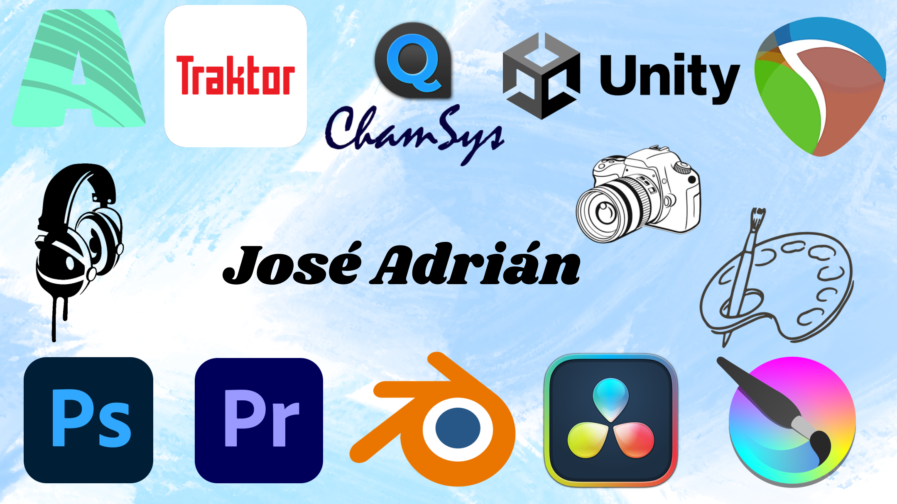

  

## Hi there 👋 My name is José Adrián García Morales
Soy alumno de primero de Creación de videojuegos, Animación y entornos interactivos. Supere previamente un grado medio en Disc-Jokey es decir soy Tecnico en Imagén y sonido, aprendi a utilizar Adobe Photoshop, Adobe Premier, Resolumen Arena, Adobe Auditión, Reaper, Traktor, Rekorbox 7 y Magic Q (Chamsys). Ahora estoy aprendiendo Krita, Unity, Blender y DaVinci Resolve.
<!--
**jadriangamo-afk/jadriangamo-afk** is a ✨ _special_ ✨ repository because its `README.md` (this file) appears on your GitHub profile.

Here are some ideas to get you started:

- 🔭 I’m currently working on ... 
- 🌱 I’m currently learning ... Blender, Krita y Unity
- 👯 I’m looking to collaborate on ...
- 🤔 I’m looking for help with ...
- 💬 Ask me about ...
- 📫 How to reach me: ...
- 😄 Pronouns: ...
- ⚡ Fun fact: ...
-->
